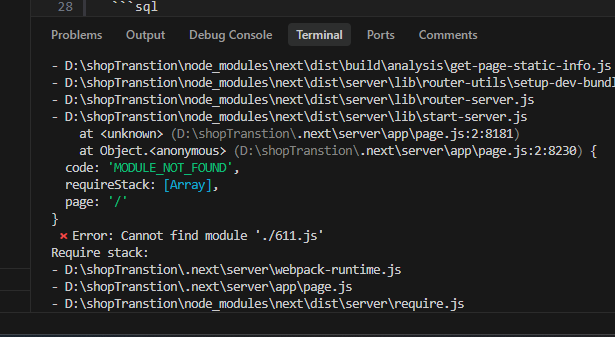

# Project Overview: Single-Page Dual-Shop MFS Ledger

## 1. Description & Objective
A lightweight, single-page web application designed for mutual MFS (bKash, Nagad, Rocket, Upay) ledger tracking between two partnered shops (Shop A and Shop B). 
The primary objective is to log and track money exchange, cash-ins, cash-outs, transaction IDs, and screenshot proofs in real-time, displaying a cumulative daily net balance showing who owes whom.

---

## 2. Authentication & Access
- **No Complex Auth / No Passwords / No OTP:**
  - Login strictly via phone number input (e.g., `017XXXXXXXX` vs `019XXXXXXXX`).
  - The UI identifies the logged-in shop based on the entered phone number.
  - State persistence via `localStorage` or session cookie so page refresh keeps the user logged in.
  - Option to switch / logout easily.

---

## 3. Technology Stack
- **Database:** Neon Serverless PostgreSQL (`@neondatabase/serverless`).
- **Backend / API:** Next.js Route Handlers (API routes) OR Express.js.
- **Frontend:** Single-Page React (Next.js App Router / Vite + React) styled with Tailwind CSS.
- **File Storage:** Direct image upload via Cloudinary, Imgur, or base64 storage in DB/S3 for screenshot proofs.

---

## 4. Database Schema (Neon PostgreSQL)

```sql
CREATE TYPE mfs_provider AS ENUM ('bkash', 'nagad', 'rocket', 'upay');
CREATE TYPE transaction_status AS ENUM ('pending', 'sent', 'received', 'rejected');
CREATE TYPE transaction_direction AS ENUM ('give', 'take'); -- 'give': I gave money, 'take': I received/requested money

CREATE TABLE transactions (
    id SERIAL PRIMARY KEY,
    sender_phone VARCHAR(20) NOT NULL,
    receiver_phone VARCHAR(20) NOT NULL,
    mfs_type mfs_provider NOT NULL,
    customer_phone VARCHAR(20) NOT NULL,
    amount NUMERIC(12, 2) NOT NULL,
    direction transaction_direction NOT NULL,
    trx_id VARCHAR(100),
    screenshot_url TEXT,
    status transaction_status DEFAULT 'pending',
    notes TEXT,
    created_at TIMESTAMP WITH TIME ZONE DEFAULT CURRENT_TIMESTAMP,
    updated_at TIMESTAMP WITH TIME ZONE DEFAULT CURRENT_TIMESTAMP
);

CREATE INDEX idx_transactions_date ON transactions (created_at);
CREATE INDEX idx_transactions_phones ON transactions (sender_phone, receiver_phone);